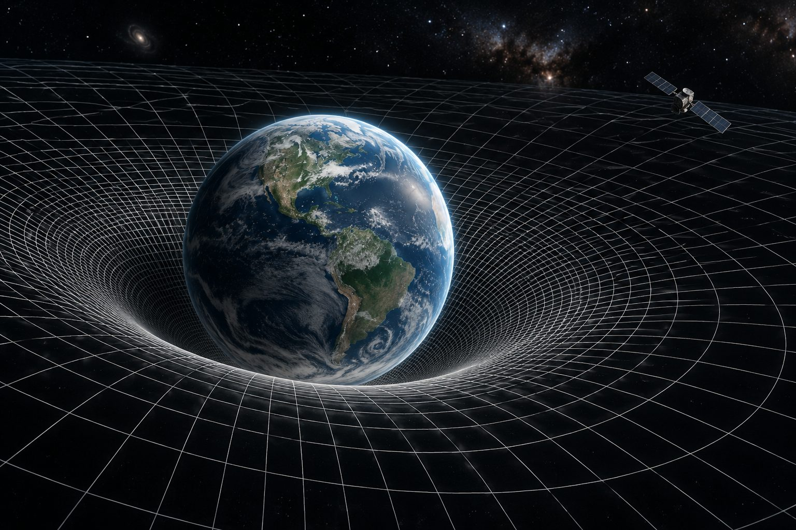
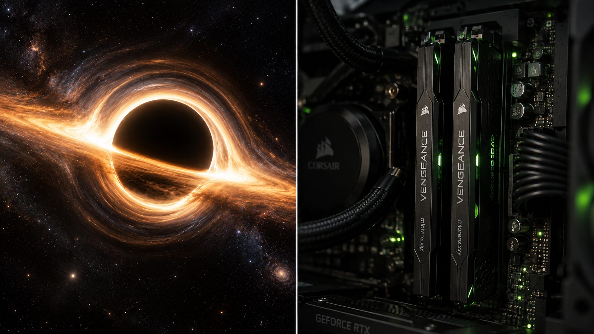
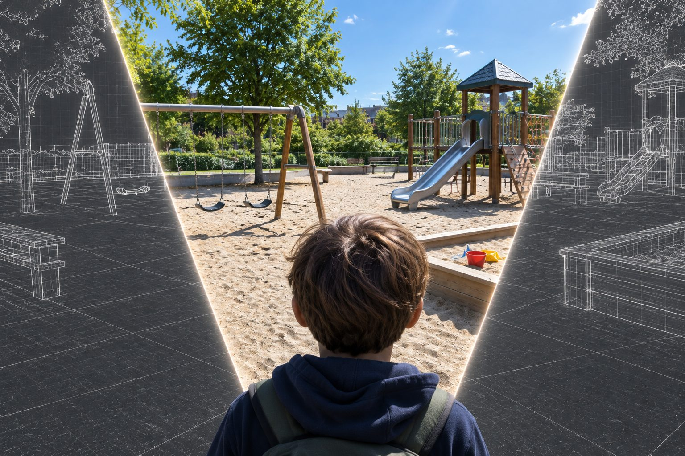

If we were living inside a simulation, what would give it away? Probably not a glitch in the sky. More likely it would be the rules themselves: laws of physics that look suspiciously like engineering decisions. Here are three that make me wonder.

## Clue 1: Time slows where there's more to compute

Near a massive object, time runs slower than it does out in empty space. It's measurable: clocks on GPS satellites tick slightly faster than clocks on the ground, and engineers have to correct for it.

Now think of a video game. The more polygons packed into a scene, the longer each update takes. Walk into a dense city and the frame rate drops; walk out into an empty field and it recovers.

If the universe were running on hardware, you'd expect exactly this: the more matter in a region, the slower its clock.

## Clue 2: Black holes behave like memory erasure

A black hole takes whatever falls in and shreds it beyond recognition. For a long time, physicists argued about whether that information is gone for good. Most now think it isn't. It slowly leaks back out in the faint radiation black holes give off, called Hawking radiation. But getting it back would mean catching almost all of that radiation, over more time than the universe has existed, and then somehow piecing it together.

Your computer works the same way. When a bit of memory is erased, a tiny bit of heat is released, and physics says it has to be. In theory, that heat still holds traces of what was stored. In practice, the data is gone and the space is free for something new.

Technically saved, practically lost. That's how a black hole treats information, and it's how a computer clears its memory.

## Clue 3: Reality isn't rendered until something looks

Until it's measured, an electron has no definite position, just odds. Fire electrons at two slits and they build up a striped pattern, as if each went through both. Check which slit they used, and the stripes vanish. Open-world games cut the same corner to save computing power, generating a region only when you head toward it.

Entangled electrons must have opposite spins, yet neither picks a direction until one is measured, and then the other settles instantly, even light-years away. It's like a road between two ungenerated regions: whichever side you reach first, the other is built to match.

Vague until needed, precise once checked.

---

None of this proves anything, of course. Every one of these clues has a perfectly good explanation in ordinary physics. But if someone did build a universe on a budget, these are exactly the corners I'd expect them to cut.
